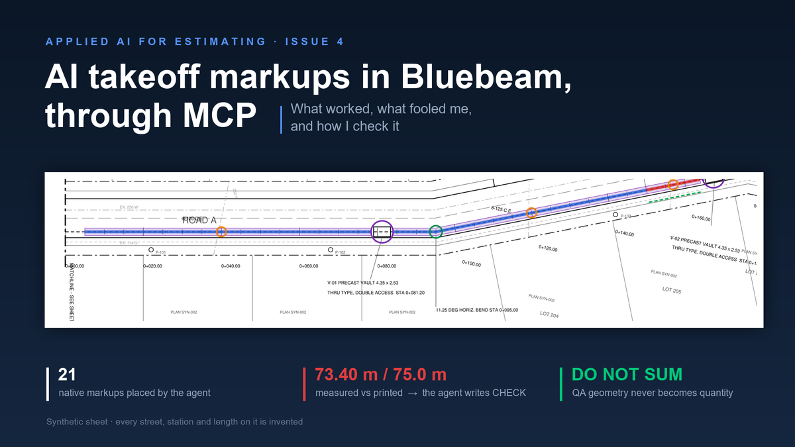

# civil-takeoff-markups-mcp

A method for letting an AI agent place **native takeoff measurements** on civil drawings in a PDF markup tool — and, more importantly, the rules that make those measurements checkable afterwards.

This repository is the method, not a product. It contains the written procedures, a synthetic drawing you can run it against, and small dependency-free scripts that enforce the two rules that matter: every markup is traceable, and no machine can mark a quantity approved.



> The figure is `examples/synthetic_sheet.pdf`. Every street, station, structure and length on it is invented. Real tender drawings belong to their owners.

**Also available:** an optional [municipal pre-bid risk check](docs/municipal-context-check.md) for permit, code, fee and schedule risks that a takeoff alone cannot detect.

## The problem this solves

General vision models read technical drawings poorly. Benchmarks built for exactly this question find that even frontier models struggle with measurement reading and fine-grained spatial grounding ([MeasureBench](https://arxiv.org/abs/2510.26865), [Picard et al.](https://arxiv.org/abs/2311.12668)). And the connector that lets an agent work inside a markup tool doesn't transmit the drawing itself: Bluebeam's documentation states that non-textual drawing details such as linework and shapes are not transmitted ([Revu and MCP](https://support.bluebeam.com/revu/resources/revu-mcp.html)).

So the agent has hands and no eyes.

**The idea:** stop asking the model to see. A civil drawing exported from CAD is not a picture — it is vector geometry with exact coordinates, stations as text at known positions, and schedules as tables. Read the geometry out of the file, do arithmetic on it, and use the connector for the one thing it does well: placing a native markup at exact coordinates.

The file supplies the geometry. A person decides what to measure. The model does the tedious middle.

## What's here

| Path | What it is |
|---|---|
| `docs/method.md` | The pipeline, step by step |
| `docs/traceability-contract.md` | How every markup is named, and why the record lives outside the PDF |
| `docs/qa-lifecycle.md` | The status ladder. What an agent may set, and what only a person may set |
| `docs/failure-modes.md` | Ways this fooled me, and the checks that survived |
| `docs/municipal-context-check.md` | Optional jurisdiction-specific permit/fee/timing preflight, with evidence and human review rules |
| `docs/mcp-notes.md` | Practical notes on the connector: payload shape, measurement intents, what it can't do |
| `tools/build_synthetic_sheet.py` | Generates the synthetic plan-and-profile sheet and derives the markup geometry from it |
| `tools/place_markups.py` | Turns that geometry into ready `add_markup` payloads |
| `tools/validate_register.py` | Checks a register row against the traceability contract |
| `tools/qa_state_transitions.py` | Checks a proposed status change against the lifecycle |
| `tools/validate_municipal_checks.py` | Checks the municipal evidence register and flags unanswered questions |
| `examples/` | Synthetic drawings, 21 agent-placed markups, derived geometry, and a fictional municipal-check register |
| `tests/test_municipal_checks.py` | Dependency-free tests for the municipal-review guardrail |

## Try it

```bash
pip install pymupdf
python tools/build_synthetic_sheet.py     # writes examples/synthetic_sheet.pdf + derived_markups.json
python tools/place_markups.py             # prints add_markup payloads for those markups
python tools/qa_state_transitions.py AI_PROPOSED APPROVED --actor automation   # exits 1, as it should
```

Then open `examples/synthetic_sheet.pdf` in a markup tool with an MCP connector, set the page scale to 1 mm = 0.5 m, and have your agent send the payloads. Read the markups back: the tool computes the lengths and areas, not the model.

On the reference run the tool returned 73.40, 66.00, 14.00 and 75.00 m. The sheet's own schedule prints 75.0 m for the first run — deliberately. That run is the point of the whole exercise: the agent does not pick a winner, it writes `CHECK` and shows both numbers.

## Optional pre-bid jurisdiction check

A correct quantity can still become a bad bid if the team misses local permits, fee schedules, right-of-way requirements or approval delays. A human estimator entering a municipality for the first time can miss these too.

The [municipal context preflight](docs/municipal-context-check.md) is a **separate** risk register, not a Bluebeam measurement or automated compliance claim. The agent records applicable official sources, dates, responsibility and possible cost/schedule consequences; missing evidence stays OPEN or FLAGGED for an estimator. It never silently clears requirements or authorizes a bid.

```bash
python tools/validate_municipal_checks.py examples/municipal_checks_synthetic.json
# exits 1: REVIEW REQUIRED (five deliberately open fictional checks)
python -m unittest discover -s tests -v
```

## The three rules

**1. Reading a quantity back is not verification.** It proves the tool measured the path you gave it. It says nothing about whether that path is on the right feature. Independent evidence has to be a *different kind* of evidence: a dimension printed on the drawing, the drawing's own vector geometry, or a rendered image of the markup in place that a person looks at.

**2. Some geometry is not quantity.** Markups that exist only to check other markups carry `QA CHECK - DO NOT SUM` in the subject, and the roll-up excludes them by rule, not by memory.

**3. Approval is not a machine state.** An agent may set `AI_PROPOSED`, `MEASURED`, `QA_CHECKED`. It may never set `ESTIMATOR_REVIEWED` or `APPROVED`. `tools/qa_state_transitions.py` enforces this so a prompt can't talk its way past it.

## What this is not

It is not a takeoff product, a legal compliance engine, or a live municipal-code lookup service, and it does not decide what to measure. Measurement rules are local — [CESMM](https://www.ice.org.uk/areas-of-interest/infrastructure-delivery/civil-engineering-standard-measurement) in one country, a national norm in another, an owner's schedule of quantities in a third. What doesn't change with the rulebook is the traceability underneath: a markup, an ID, a source, a status, and a person who signs.

It also has a clear weak spot. Scanned drawings have no vector content, so there is no exact geometry to read, and the method falls back to a person drawing the measurement and the agent tagging and reconciling it.

No proprietary drawings, tool libraries or company data are included here, and none should be added. Everything in `examples/` is synthetic.

## Limitations

- **It does not see the drawing.** Geometry comes from the PDF's vector content. Scanned sheets have none, and the method falls back to a person drawing the measurement.
- **It will assert a negative from the folder it happened to search.** An agent once reported "no marking standard in the package" after reading 25 PDFs in one tree; the standard was among 253 in another. A negative is only as good as the tree searched, and the register records which trees were searched so the claim can be checked rather than believed.
- **It reads clauses wider than they are written.** The same agent read a clause about temporary raised markers as the permanent painted pattern. The check that caught it was a second session opening the clause itself before accepting the citation. Citations carry page and clause, and someone other than the author of the claim reads them.
- **Withdrawals are logged, not deleted.** A blank cell with a reason beats a filled one with a guess.
- **Counts** cannot be created as live count measurements through the connector in the environment this was built in.
- **Connector behaviour changes.** See the dated notes in `docs/mcp-notes.md`.

## Background reading

Automation bias is the reason the rules above are shaped the way they are. A systematic review of 74 studies found people over-rely on automated advice, that inexperience and time pressure make it worse, and that what helps is showing confidence alongside the output and keeping accountability with the user ([Goddard, Roudsari & Wyatt, JAMIA 2012](https://academic.oup.com/jamia/article/19/1/121/732254)). An estimating department on bid day has time pressure by design, so the mitigations belong in the file itself.

## Contributing

Tell me where it breaks. Different drawing conventions, different measurement standards, a failure mode not in `docs/failure-modes.md` — those are the most useful issues to open.

MIT licensed.
